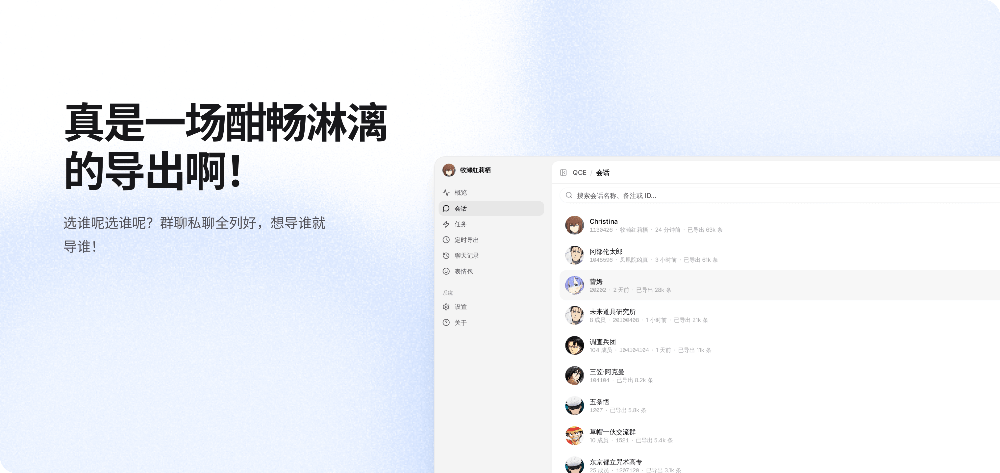
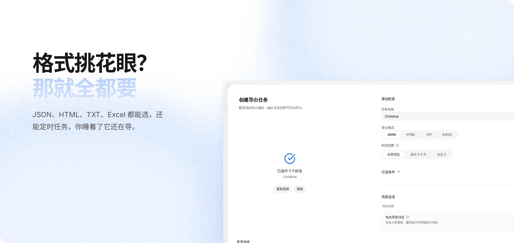
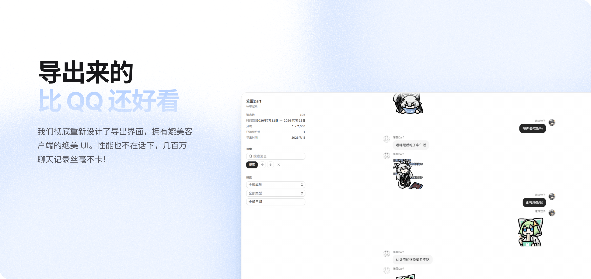
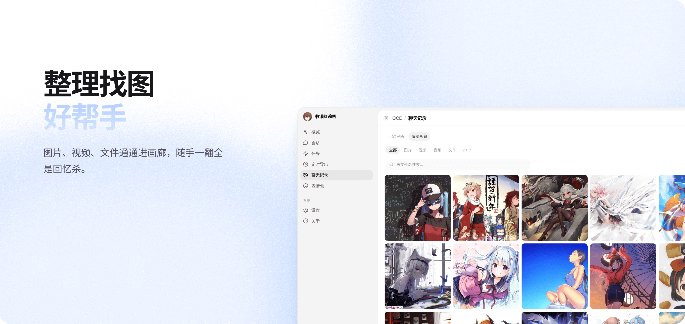
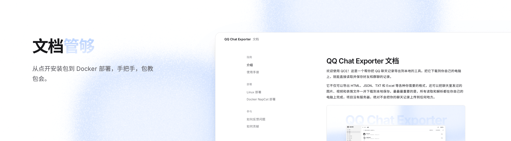
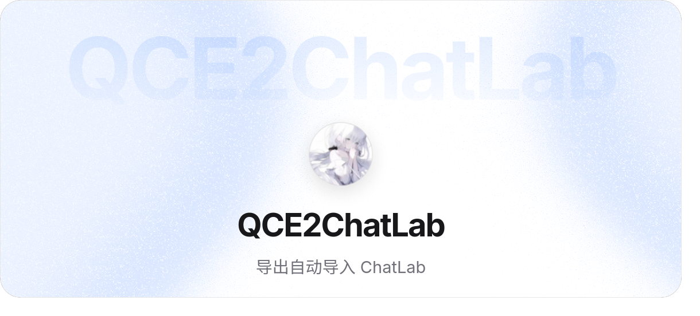
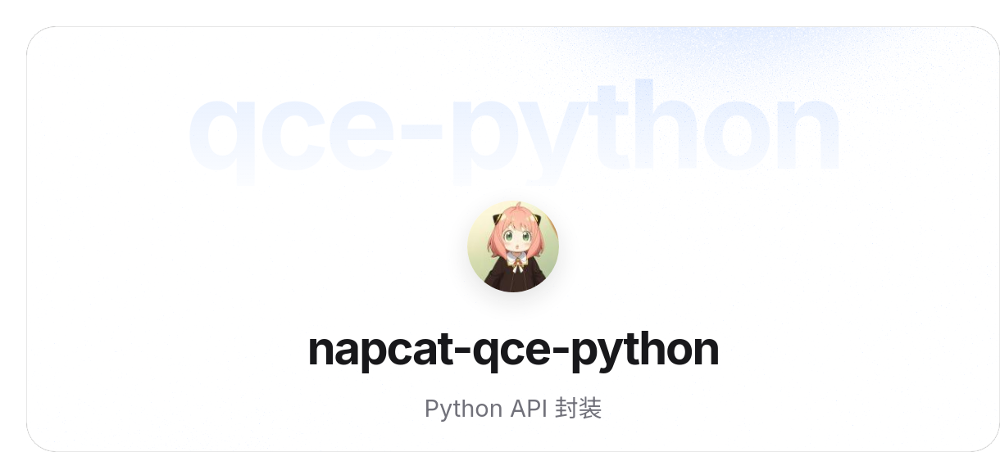

# QQ Chat Exporter 本地修改版源码

这是基于 [shuakami / qq-chat-exporter](https://github.com/shuakami/qq-chat-exporter) 的源码快照，
上游基线为 `4ae4b700939346b46b05b46346fb5c5c5f08b081`，由 Moraphia 于 2026-11-03 整理发布。
原作者署名与 [GPL-3.0 许可证](LICENSE) 保留；本仓库不代表上游发布或背书。

## 本地修改

- Node ↔ Rust 本地桥接增加每次启动随机生成的 Bearer 令牌，并以恒定时间比较验证。
- Rust API 默认仅监听 `127.0.0.1`。
- 主界面移除 Vercel Analytics 和额外远程字体加载，调整依赖与锁文件。
- Windows 漫游导出重试测试正确消费 HTTP 请求后再返回合成错误。
- 排除本机部署目录、审计文件、依赖、运行配置与聊天导出。

完整变更路径与基线见 [SOURCE_SNAPSHOT.json](SOURCE_SNAPSHOT.json)。

## 源码结构和验证

插件桥接位于 `plugins/qq-chat-exporter`，Rust 服务端位于 `qq-chat-export-server`，
导出核心位于 `qq-chat-export-core`，主界面位于 `qce-v4-tool`。
需要 Node.js、npm、pnpm 9 和 Rust/Cargo；各部分命令见 [AGENTS.md](AGENTS.md)。

```bash
git clone https://github.com/Moraphia/qq-chat-exporter.git
cd qq-chat-exporter/plugins/qq-chat-exporter
npm ci
npm run gen:overlay
npm run typecheck
npm test
```

```bash
cd qq-chat-export-server
cargo test --locked
```

第二组命令从仓库根目录执行。安装与打包使用上游 `scripts` 下的构建脚本，
需要自行取得兼容 NapCat/QQ 运行时；本仓库不附带运行时、登录状态或可直接运行的安装包。
上游未配置 URL 的 `.napcat-src` Git 链接未收录；测试用 overlay 可由脚本生成。

## 隐私和许可

只收录源码、公开素材和通用模板。Docker 中的配置来自上游公开模板，不含本机登录信息。
首次运行请设置独立访问令牌。公开 issue 不要附带二维码、配置、密钥或聊天文件。
详见 [PRIVACY.md](PRIVACY.md)、[SECURITY.md](SECURITY.md) 与
[THIRD-PARTY-NOTICES.md](THIRD-PARTY-NOTICES.md)。

以下保留上游说明，其中下载、文档及联系链接属于上游。

---

[![][image-banner]][releases-link]

这是一个帮你把 QQ 聊天记录导出到本地的工具。把它下载到你自己的电脑上，就能直接读取并保存好友和群聊的记录。

它不仅可以导出 HTML、JSON、TXT 和 Excel 等各种你需要的格式，还可以将聊天中发过的图片、视频和表情文件一并下载到本地保存。最最最重要的是，所有读取和解析都在你自己的电脑上完成，项目没有服务器或数据传输，绝对不会把你的聊天记录上传到任何地方。

**[使用文档][docs-link]** **[下载][releases-link]** **[Docker 部署][docker-doc]** **[反馈问题][issues-link]**

[![][github-release-shield]][releases-link]
[![][github-downloads-shield]][releases-link]
[![][github-stars-shield]][stars-link]
[![][github-license-shield]][license-link]

> \[!IMPORTANT]
>
> **Star 一下**，你将第一时间收到 GitHub 上的新版本发布通知哟

## 特性









## 快速开始

### Windows 一键安装（推荐）

1. 从 [Releases][releases-link] 下载一键安装包并运行
2. 用 QQ 扫码登录
3. 打开 `http://localhost:40653/qce`，开始导出

### Shell 模式（Windows / Linux / macOS Apple Silicon 预览）

1. 从 [Releases][releases-link] 下载对应平台的压缩包
2. 运行 `launcher-user.bat`（Windows）或 `./launcher-user.sh`（Linux / macOS）
3. 用 QQ 扫码登录，控制台会打印一键登录链接，打开即可
4. 也可手动访问 `http://localhost:40653/qce`，令牌见控制台输出；在「设置 → 启动」里可开启登录后自动打开浏览器

> \[!NOTE]
> macOS 当前仅提供 Apple Silicon（arm64）预览包，且启动前需要完全退出电脑上的 QQ，详见 [macOS 使用指南][macos-doc]。

### Docker 一键部署

适用于 macOS（含 Apple Silicon）、Linux、Windows，无需安装 QQ 客户端：

```bash
git clone https://github.com/shuakami/qq-chat-exporter.git
cd qq-chat-exporter/docker
docker compose up -d

# 查看登录二维码与 Token
docker logs -f napcat-qce
```

> \[!NOTE]
> Apple Silicon (M1/M2/M3/M4) 通过 Rosetta 模拟运行，首次启动可能稍慢。详见 [Docker 部署指南][docker-doc]。

## 文档

[][docs-link]

## 相关项目

[](https://chatlab.fun/cn)

<p><a href="https://github.com/Ruoan-486/QCE2Chatlab"></a><a href="https://github.com/CutrelyAlex/QQChatAnalyzer"></a><a href="https://github.com/JUSTMONIKA2022/QQ-Chat-AI-Analyzer"></a><a href="https://github.com/streetartist/napcat-qce-python"></a></p>

我们非常欢迎和 QCE 有关的社区项目！如果需要展示您的项目，可以在[这里](https://github.com/shuakami/qq-chat-exporter/issues/new)提一个 issue。

## 贡献者

感谢每一位让 QCE 变得更好的贡献者，也感谢 [NapCatQQ](https://github.com/NapNeko/NapCatQQ) 团队提供的框架支持。参与开发？请阅读[贡献指南](https://shuakami.github.io/qq-chat-exporter/docs/contributing.html)。

<a href="https://github.com/shuakami/qq-chat-exporter/graphs/contributors">
  
</a>

## 许可证

[GPL-3.0][license-link]

<!-- LINK GROUP -->

[image-banner]: docs/images/banner.png
[docs-link]: https://shuakami.github.io/qq-chat-exporter/
[releases-link]: https://github.com/shuakami/qq-chat-exporter/releases
[issues-link]: https://github.com/shuakami/qq-chat-exporter/issues
[stars-link]: https://github.com/shuakami/qq-chat-exporter/stargazers
[license-link]: LICENSE
[docker-doc]: https://shuakami.github.io/qq-chat-exporter/docs/docker-napcat-deployment.html
[macos-doc]: https://shuakami.github.io/qq-chat-exporter/docs/macos-deploy.html
[github-release-shield]: https://img.shields.io/github/v/release/shuakami/qq-chat-exporter?color=317cfe&labelColor=black&logo=github&style=flat-square
[github-downloads-shield]: https://img.shields.io/github/downloads/shuakami/qq-chat-exporter/total?color=317cfe&labelColor=black&style=flat-square
[github-stars-shield]: https://img.shields.io/github/stars/shuakami/qq-chat-exporter?color=317cfe&labelColor=black&style=flat-square
[github-license-shield]: https://img.shields.io/badge/license-GPL--3.0-317cfe?labelColor=black&style=flat-square
